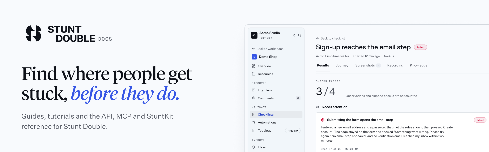

<picture>
  <source media="(prefers-color-scheme: dark)" srcset=".github/readme/header-dark.png">
  
</picture>

<p>
  <a href="https://github.com/stunt-double/docs/actions/workflows/ci.yml"></a>
  <a href="https://github.com/stunt-double/docs/actions/workflows/github-code-scanning/codeql"></a>
  <a href="https://docs.stuntdouble.io"></a>
  <a href="https://github.com/stunt-double/stuntdouble-mcp/releases"></a>
  <a href="./LICENSE"></a>
  <a href="./LICENSE-CONTENT"></a>
</p>

# Stunt Double docs

[Stunt Double](https://stuntdouble.io): authentic user insights from autonomous AI agents, backed by evidence.

This is the source for [docs.stuntdouble.io](https://docs.stuntdouble.io): guides, tutorials, concepts, and the API, MCP and StuntKit reference.

## Run it locally

```bash
pnpm install
node scripts/fetch-sources.mjs && node scripts/generate.mjs   # the linked MCP pages
pnpm dev          # http://localhost:3000
pnpm test         # node --test
pnpm type-check
pnpm build        # fetches linked sources, generates their pages, then builds
```

## Where content lives

- `content/docs/`: pages written here. Edit these directly.
- Linked sources: the MCP server reference, skills and rules come from [`stunt-double/stuntdouble-mcp`](https://github.com/stunt-double/stuntdouble-mcp). `sources.json` lists them. The build reads each at its latest release tag (or a pinned commit) into `.sources/`, which is never committed. To change those pages, change the source repo.

## Screenshots

Product screens in the docs are faithful redraws of the dashboard, built in the
Figma file [Docs screenshots](https://www.figma.com/design/JBFOSb3uMqBImmPYwYVdQL)
from the Continuity Design System library (its components, text styles and
colour variables), so they stay on brand and in step with the product. Each
frame has a light twin and a dark twin (the library's Dark mode), exported at
1440 wide to `public/screens/<name>-light.png` and `<name>-dark.png`. Pages use
them through `<Screenshot name="..." alt="..." caption="..." />`, which swaps
the file with the site theme. The README header (`.github/readme/header-light.png`
and `header-dark.png`) lives in the same file, exported at 2x. To update one, edit the light frame, re-clone its
dark twin, and re-export both.

## For agents

- `/llms.txt` indexes every page and `/llms-full.txt` holds them all; both are linked from the sidebar.
- `/.well-known/agents.md` says when to use the docs and how to act through the MCP server.
- Any page is Markdown at its path plus `.md`, or with `Accept: text/markdown`.
- `robots.txt` names the AI crawlers it allows.

## Contributing

See [CONTRIBUTING.md](./CONTRIBUTING.md). Report security issues as described in [SECURITY.md](./SECURITY.md).

## License

Code: [MIT](./LICENSE). Content: [CC BY 4.0](./LICENSE-CONTENT).
